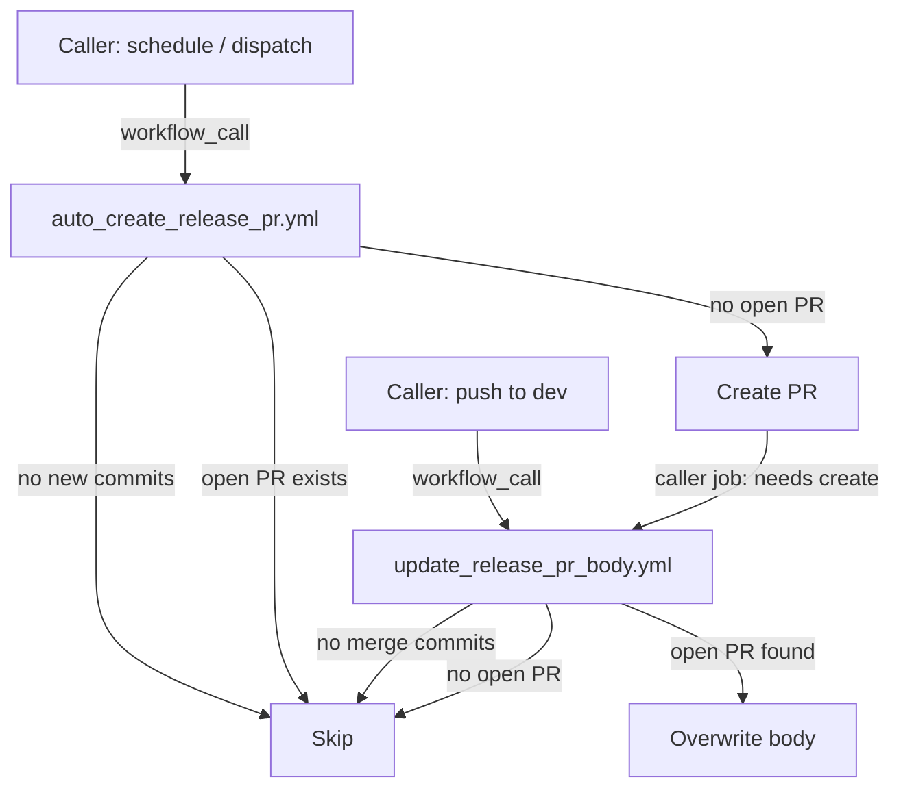
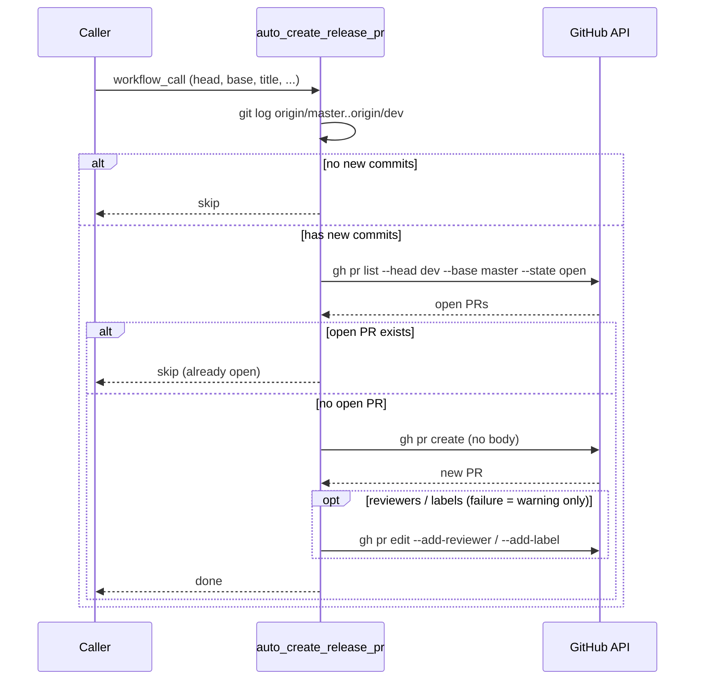
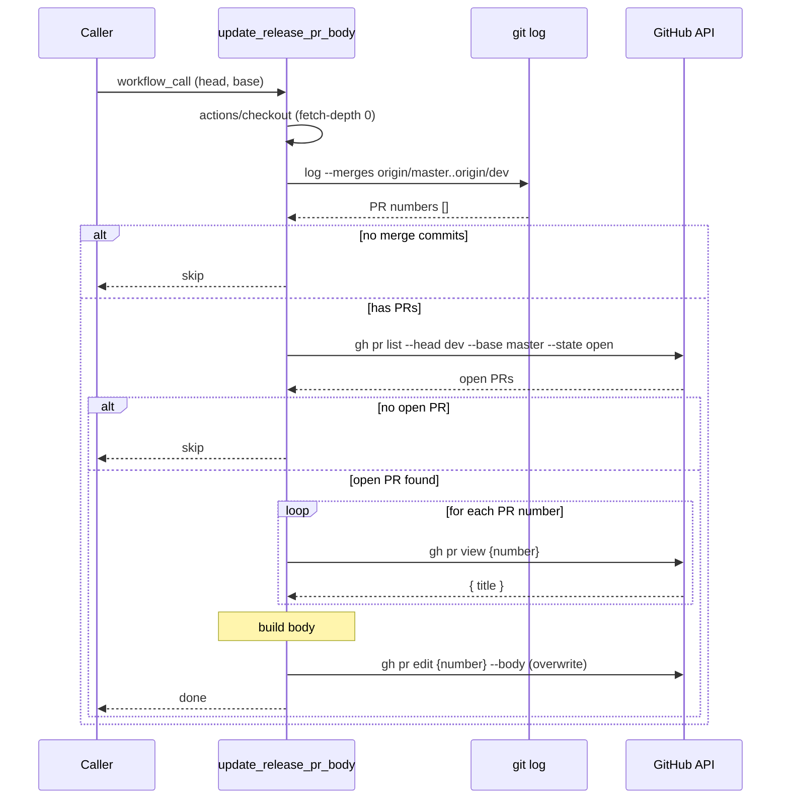

# Plan: Auto Create Release PR Reusable Workflow

> 🟠 In Progress — PR #56 open, pending review and merge

## 1. Goal

在 `cp-workflow-template` 新增**兩個** `workflow_call` reusable workflow，讓 caller repo（如 `api-automation-jest`）能：
1. 手動或排程自動發 `dev → master` PR（`auto_create_release_pr.yml`）
2. 每次有 PR merge 進 `dev` 時自動更新 PR body，列出所有尚未進 master 的 PR（`update_release_pr_body.yml`）

**Success criterion**: `api-automation-jest` 引用後，排程能開出 PR；新 PR merge 進 dev 時，dev→master PR body 自動更新列出最新 PR list；head == base 時 job 結束但不開 PR。

## 2. Context

各 repo 有 `dev` branch 定期累積功能，但手動發 release PR 容易忘記或拖延。將此邏輯放進 template repo，讓所有需要的 repo 都能以幾行 YAML 引用，統一維護點。

PR body 若只在「開 PR 當下」生成，之後新 merge 進 dev 的 PR 就不會反映在 body 裡。拆成兩個 workflow 解決這個問題：`auto_create_release_pr` 負責「開不開 PR」，`update_release_pr_body` 負責「body 保持最新」。

`GITHUB_TOKEN` 開的 PR 不會觸發其他 `pull_request` workflow（GitHub 安全限制），因此必須用 PAT（`PERSONAL_ACCESS_TOKEN`）。

## 3. Scope

### In scope

- [ ] 新增 `.github/workflows/auto_create_release_pr.yml`（`workflow_call`）
  - [ ] 無新 commit（head == base）時 skip，job 正常結束
  - [ ] 已有開著的 head→base PR 時不重複開（直接結束）
  - [ ] 否則開新 PR（無 body，由 `update_release_pr_body` 負責）
  - [ ] Inputs：`head_branch`、`base_branch`、`pr_title`、`reviewers`、`labels`、`draft`
  - [ ] Secrets：`PERSONAL_ACCESS_TOKEN`
- [ ] 新增 `.github/workflows/update_release_pr_body.yml`（`workflow_call`）
  - [ ] Checkout repo（`fetch-depth: 0`）
  - [ ] `git log --merges` 抓 PR numbers（merge commit 策略）
  - [ ] GitHub API `GET /pulls/{number}` 取準確 PR title
  - [ ] 找到開著的 head→base PR → 覆蓋 body
  - [ ] 找不到開著的 PR → skip（body 更新無意義）
  - [ ] Inputs：`head_branch`、`base_branch`
  - [ ] Secrets：`PERSONAL_ACCESS_TOKEN`
- [ ] 補 README：兩個 workflow 的使用說明 + `api-automation-jest` 兩個 caller 範例

### Out of scope (explicit)

- api-automation-jest repo 的實際 caller workflow 檔案（只提供範例，不送 PR 到對方 repo）
- 開 PR 後自動 assign reviewers（已有 `assign_reviewers.yml`，caller 可自行串）
- Slack 通知（caller 可自行串 `notify_slack.yml`）
- Squash merge / rebase merge 的支援（caller repo 須使用 merge commit 策略）
- PR body 格式的 emoji icons（`gen-release-pr-numbers.js` 的功能，本次不複製）

### Deferred

- `update_release_pr_body.yml` 支援 squash merge（需改用 GitHub API `commits/{sha}/pulls`，目前 caller 用 merge commit，暫不需要）

## 4. Approach

### Workflow 1：`auto_create_release_pr.yml`（開 PR）

`actions/checkout`（fetch-depth: 0）+ `gh` CLI（PAT 經 `GH_TOKEN`）。

**步驟：**
1. `git log origin/{base}..origin/{head}` 為空 → skip
2. `gh pr list --head {head} --base {base} --state open` → 已有 PR → skip（不重開）
3. `gh pr create` 開新 PR（body 暫時留空，由 workflow 2 填）
4. 若有 reviewers/labels → 開 PR 之後各自 `gh pr edit --add-reviewer` / `--add-label`；失敗只發 `::warning::`，不讓 job 失敗（PR 已存在，之後的 run 都會 skip，job 紅了也不會重試）
5. Caller 在同一個 workflow 以 `needs:` 接 `update_release_pr_body`，讓新 PR 立刻有 body

### Workflow 2：`update_release_pr_body.yml`（更新 body）

需要 `actions/checkout`（fetch-depth: 0）+ `gh` CLI。Job 設 `concurrency`（`cancel-in-progress`），避免連續 push 時舊的 run 晚完成、用舊列表覆蓋 body。

**Inputs：** `head_branch`（預設 `dev`）、`base_branch`（預設 `master`）

**步驟：**
1. checkout
2. `git log --merges --reverse --grep='Merge pull request #' --pretty='%s' origin/{base}..origin/{head}` → 以 `^Merge pull request #\K[0-9]+` 抓 PR numbers（`|| true`：grep 無 match 時 exit 1，預設 `bash -e` 會直接中止）
3. 無 merge commit → skip（輸出 info，正常結束）
4. `gh pr list --head {head} --base {base} --state open` 找開著的 release PR
5. 找不到 → skip（PR 尚未建立，等排程跑）
6. 對每個 PR number 循序 `gh pr view` 取 title；失敗時填 `(title unavailable)`
7. 組成 body（`- #number title` 格式），`gh pr edit --body` 覆蓋

### Body 格式

```markdown
## Included PRs

- #123 feat: add wallet connect
- #456 fix: token refresh

---
*Auto-generated by [update_release_pr_body](https://github.com/CoolBitX-Technology/cp-workflow-template)*
```

### 為何用 git log + API 混合方式

- git log `--merges --grep='Merge pull request #'`：可靠抓到 PR number，不依賴 commit body 格式，不需 N+1 API 呼叫
- GitHub API `GET /pulls/{number}`：取得準確的 PR title（比解析 git log body 穩定）
- 循序 `gh pr view` 取 title：PR 數量通常 < 50，不會觸發 rate limit

## 5. Alternatives considered

### Alternative A: 全部用 GitHub API（`commits/{sha}/pulls`）
- **What**: 對每個 commit SHA 呼叫 GitHub API 查 PR 關聯，不需要 checkout
- **Why not**: N+1 循序 API calls（已驗證會有 secondary rate limit 風險）；squash merge commit 關聯不穩定；`update_release_pr_body` 需要常跑（每次 dev push），API 呼叫量大

### Alternative B: 完全用 git log 解析（`gen-release-pr-numbers.js`）
- **What**: 解析 commit message body（`%b`）抓 PR title，不呼叫 API
- **Why not**: title 依賴 git log body 格式，GitHub 的 merge commit body 不保證包含 PR title（多個 commit 的 PR body 格式不固定）；API 取 title 更可靠

### Alternative C: 單一 workflow 負責開 PR + 生成 body
- **What**: 原始設計，只在排程觸發時更新 body
- **Why not**: 新 PR merge 進 dev 後，body 要等到下次排程（最長一週）才更新，體驗差

## 6. Diagrams

### 整體架構



### Sequence: auto_create_release_pr



### Sequence: update_release_pr_body



## 7. PR Breakdown

### PR 1: Add both reusable workflows + README — ~500 lines
- **Category**: Feature
- **Branch**: `feat/CW-29348-auto-create-release-pr`
- **Goal**: 兩個 workflow 合入一個 PR，因為 `update_release_pr_body` 的 caller 範例需要對照 `auto_create_release_pr` 才有意義
- **Depends on**: none
- **Merge order**: 1st
- **Commits**:
  - [ ] `feat(workflow): add auto_create_release_pr reusable workflow`
  - [ ] `feat(workflow): add update_release_pr_body reusable workflow`
  - [ ] `docs(readme): add usage and caller examples for both workflows`

---

> 若 diff 超過 300 行，可拆為：PR 1（`auto_create_release_pr` + README section 1）→ PR 2（`update_release_pr_body` + README section 2），PR 2 depends on PR 1。

## 8. Testing strategy

- **Unit tests**: 無（GitHub Actions YAML 無標準 unit test 框架）
- **Manual verification**:
  1. 在測試 repo 新增兩個 caller workflow
  2. **Case A（skip—no commits）**: dev == master，手動觸發 `auto_create_release_pr` → job 輸出 skip，無 PR 被開
  3. **Case B（create PR）**: dev 有領先 master 的 merge commits，手動觸發 → PR 被開（body 暫空）
  4. **Case C（skip—PR exists）**: 再次手動觸發 `auto_create_release_pr` → 不開第二個 PR
  5. **Case D（update body）**: 手動觸發 `update_release_pr_body` → PR body 被更新，列出 PR links
  6. **Case E（body—no open PR）**: 在無開著 PR 的情況下觸發 `update_release_pr_body` → job 正常結束，無錯誤
- **Not tested**: 排程觸發（合入 caller default branch 後由時間驗證）；squash / rebase merge（明確 out of scope）

## 9. Risks & open questions

- **Risk**: git log `--merges` 只抓 merge commit — 若 caller repo 改用 squash merge，body 會是空的。**Mitigation**: README 明確說明「需使用 merge commit 策略」；squash 支援可後續補 `update_release_pr_body` 的 fallback 路徑。
- **Assumption**: PAT 已有 `repo` scope（或 fine-grained：`Pull requests: write` + `Contents: read`）。若 PAT 權限不足 → workflow 會 403。README 需說明最小權限。
- **Assumption**: `update_release_pr_body` 以 `push: dev` 觸發（caller 設定）。若 caller 用 `pull_request: synchronize` 觸發，行為相同但語意更精確，caller 可自行選擇。
- **Open**: `api-automation-jest` 的排程頻率——caller 範例暫用 `0 2 * * 1`（週一 10:00 台北），確認後 caller 自行調整。

## 10. Done criteria

- [ ] `feat/CW-29348-auto-create-release-pr` PR 通過 review、合入 master
- [ ] CI（assign_reviewers）在 template repo 端 green
- [ ] Case A（skip）手動驗證通過
- [ ] Case B（create）手動驗證通過
- [ ] Case C（skip—PR exists）手動驗證通過
- [ ] Case D（update body）手動驗證通過，body 含 PR links
- [ ] Case E（body—no open PR）手動驗證通過
- [ ] README 含兩個 workflow 的使用說明與 caller 範例
- [ ] README 說明 merge commit 限制與 PAT 最小權限

---

## Appendix: decisions log

- 2026-10-12 — PAT secret 沿用 `PERSONAL_ACCESS_TOKEN`（與現有 `run_integration_test.yml` 一致）
- 2026-10-12 — 已有開著的 PR → 完全覆蓋 body（不 append、不加 comment）
- 2026-10-12 — ~~全用 `github-script` 實作，不依賴 `gh` CLI 或額外 action~~ → 2026-10-16 改用 `gh` CLI + `git log`（runner 內建 `gh`，script 較短）
- 2026-10-16 — 拆成兩個 workflow：`auto_create_release_pr`（開 PR）+ `update_release_pr_body`（更新 body）。原因：單一 workflow 無法在新 PR merge 進 dev 時即時更新 body
- 2026-10-16 — Body 生成改用 git log（PR numbers）+ GitHub API（PR titles）混合方式。原因：git log `--merges` 可靠抓 PR number 不需 N+1 API；API `GET /pulls/{number}` 取準確 title；caller repo 確認使用 merge commit 策略
- 2026-10-16 — `auto_create_release_pr` 開 PR 時不帶 body（留空），由 `update_release_pr_body` 負責填入
- 2026-10-19 — Review 修正：`update_release_pr_body` grep 無 match 時不再讓 job 失敗；加 `concurrency` 防覆蓋 race；reviewers/labels 改為開 PR 後非致命套用；caller 範例以 `needs:` 串接 body 更新；兩個 workflow 收斂 `permissions: contents: read`
