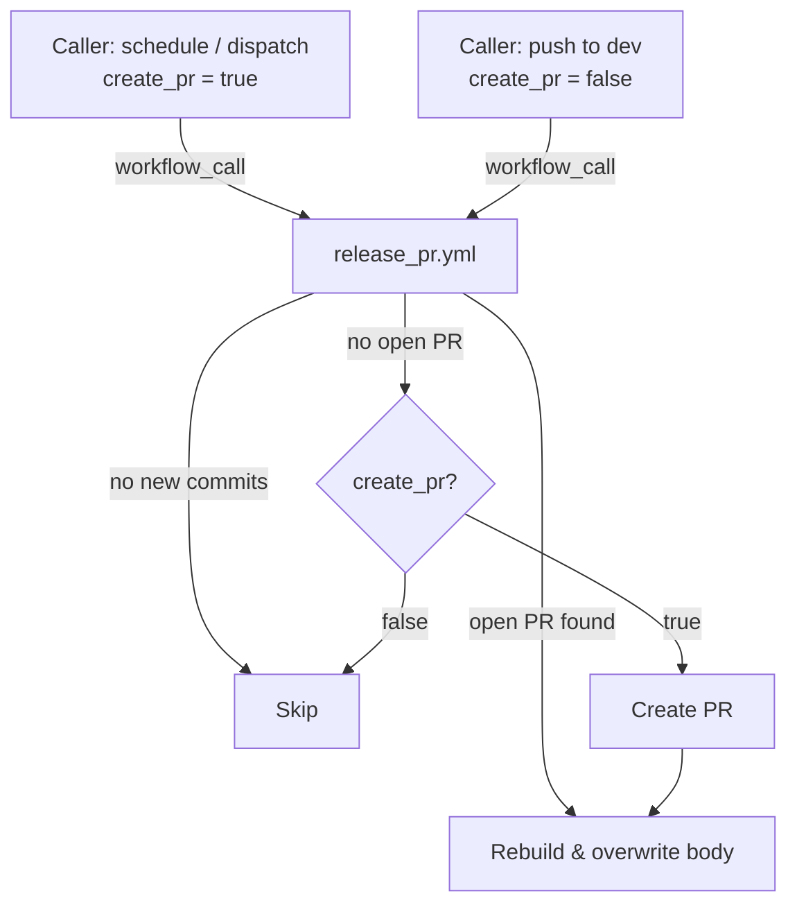
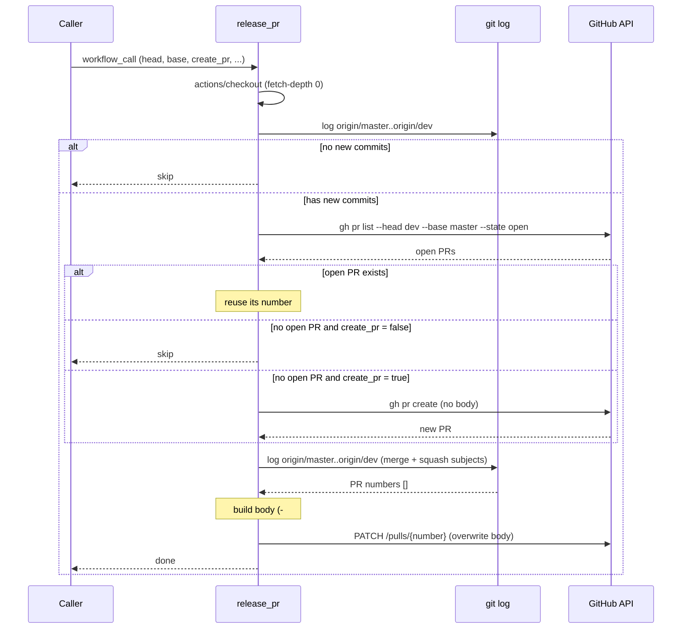

# Plan: Auto Create Release PR Reusable Workflow

> 🟠 In Progress — PR #56 open, pending review and merge

## 1. Goal

在 `cp-workflow-template` 新增**一個** `workflow_call` reusable workflow `release_pr.yml`，讓 caller repo（如 `api-automation-jest`）能：
1. 手動或排程自動發 `dev → master` PR
2. 每次有 PR merge 進 `dev` 時自動更新 PR body，列出所有尚未進 master 的 PR

**Success criterion**: `api-automation-jest` 引用後，排程能開出 PR 且 body 立即填好；新 PR merge 進 dev 時，dev→master PR body 自動更新列出最新 PR list；head == base 時 job 結束但不開 PR；push 觸發時不主動開 PR。

## 2. Context

各 repo 有 `dev` branch 定期累積功能，但手動發 release PR 容易忘記或拖延。將此邏輯放進 template repo，讓所有需要的 repo 都能以幾行 YAML 引用，統一維護點。

PR body 若只在「開 PR 當下」生成，之後新 merge 進 dev 的 PR 就不會反映在 body 裡。因此同一個 workflow 由 caller 掛兩種觸發：排程/手動（`create_pr: true`，可開 PR）與 push 到 dev（`create_pr: false`，只更新 body）。每次 run 結尾都重建 body，新開的 PR 也會立即有 body。

`GITHUB_TOKEN` 開的 PR 不會觸發其他 `pull_request` workflow（GitHub 安全限制），因此必須用 PAT（`PERSONAL_ACCESS_TOKEN`）。

## 3. Scope

### In scope

- [ ] 新增 `.github/workflows/release_pr.yml`（`workflow_call`）
  - [ ] Checkout repo（`fetch-depth: 0`）
  - [ ] 無新 commit（head == base）時 skip，job 正常結束
  - [ ] 找開著的 head→base PR；沒有且 `create_pr: false` → skip
  - [ ] 沒有且 `create_pr: true` → 開新 PR
  - [ ] `git log` 從 commit 標題抓 PR numbers（merge commit 與 squash 皆支援），以 `- #N` 列出並覆蓋 body（GitHub 自動顯示標題）
  - [ ] Job 層 `concurrency`（排隊、不取消）
  - [ ] Inputs：`head_branch`、`base_branch`、`create_pr`
  - [ ] Secrets：`PERSONAL_ACCESS_TOKEN`
- [ ] 補 README：使用說明 + `api-automation-jest` caller 範例

### Out of scope (explicit)

- api-automation-jest repo 的實際 caller workflow 檔案（只提供範例，不送 PR 到對方 repo）
- 開 PR 後指定 reviewers / 加 labels：caller（cp-node-graphql-endpoint、api-automation-jest）都已用 `assign_reviewers.yml` 在 PR opened 時指定 reviewer，也都沒有用 label，故不提供這兩個 input
- Slack 通知（caller 可自行串 `notify_slack.yml`）
- Rebase merge 的支援（rebase 後的 commit 不帶 PR 編號）
- PR body 格式的 emoji icons（`gen-release-pr-numbers.js` 的功能，本次不複製）

### Deferred

- 支援 rebase merge（需改用 GitHub API `commits/{sha}/pulls`，目前 caller 未使用 rebase merge，暫不需要）

## 4. Approach

### `release_pr.yml`

`actions/checkout`（fetch-depth: 0）+ `gh` CLI（PAT 經 `GH_TOKEN`）。

分成兩個 step：`Find or create release PR`（步驟 1–3，以 `$GITHUB_OUTPUT` 輸出 PR 編號）與 `Update release PR body`（步驟 4–5，`if: steps.pr.outputs.number != ''`）。需要 skip 時第一個 step 不輸出編號，第二個 step 在 Actions UI 顯示為 skipped。

**Inputs：** `head_branch`（預設 `dev`）、`base_branch`（預設 `master`）、`create_pr`（預設 `true`）

**步驟：**
1. `git log origin/{base}..origin/{head}` 為空 → skip
2. `gh pr list --head {head} --base {base} --state open` 找開著的 release PR
3. 找不到：
   - `create_pr: false` → skip（push 觸發，等排程開 PR）
   - `create_pr: true` → `gh pr create`（標題日期用台北時間 `TZ=Asia/Taipei`；body 留空，第 5 步填入）。PAT 開的 PR 會觸發 caller 的 `pull_request: opened`，reviewer 由 `assign_reviewers.yml` 指定
4. `git log --reverse --pretty='%s' origin/{base}..origin/{head}` → 以 `^Merge pull request #\K[0-9]+`（merge commit）或 `\(#\K[0-9]+(?=\)$)`（squash，如 dependabot）抓 PR numbers，`awk` 去重（pipeline 結束碼取最後的 `awk`，預設 `bash -e` 沒開 pipefail，grep 無 match 不會中止 step；`|| true` 只是保險）
5. 每個 PR number 寫成一行 `- #N`（GitHub 畫面上會自動展開成圖示 + 標題，不另外查標題），組成 body，用 REST `gh api -X PATCH /repos/{repo}/pulls/{number}` 覆蓋（不用 `gh pr edit`：它走 GraphQL 會查 reviewer team，只有 `repo` scope 的 classic PAT 缺 `read:org` 會失敗）；沒有任何 PR 時顯示 `_No merged PRs yet._`

**Concurrency：** group 為 `release-pr-{repo}-{head}-{base}`，`cancel-in-progress: false`。排程與 push 可能同時觸發；若取消，被取消的可能正是要開 PR 的那個 run。排隊執行也避免舊 run 晚完成、用舊列表覆蓋 body。限制：GitHub 每個 group 只保留一個等待中的 run，前一個 run 還在跑、排程 run 正在等待時又有 push 進來，排程 run 會被取代，PR 要等下次排程或手動觸發才會開（機率很低）。

**Caller：** 單一檔案掛 `schedule` / `workflow_dispatch` / `push: dev`，傳 `create_pr: ${{ github.event_name != 'push' }}`。

### Body 格式

```markdown
## Included PRs

- #123
- #456

---
*Auto-generated by [release_pr](https://github.com/CoolBitX-Technology/cp-workflow-template)*
```

### 為何用 git log 抓編號、只寫 `#N`

- git log commit 標題：可靠抓到 PR number，不依賴 commit body 格式，不需 N+1 API 呼叫
- 只寫 `#N`：列表項目裡的 PR 編號會被 GitHub 展開成「圖示 + 標題」，自己再寫標題會重複顯示；不查標題也省掉每個 PR 一次的 API 呼叫，標題還會跟著 PR 改名更新

## 5. Alternatives considered

### Alternative A: 全部用 GitHub API（`commits/{sha}/pulls`）
- **What**: 對每個 commit SHA 呼叫 GitHub API 查 PR 關聯，不需要 checkout
- **Why not**: N+1 循序 API calls（已驗證會有 secondary rate limit 風險）；squash merge commit 關聯不穩定；workflow 每次 dev push 都會跑，API 呼叫量大

### Alternative B: 完全用 git log 解析（`gen-release-pr-numbers.js`）
- **What**: 解析 commit message body（`%b`）抓 PR title，不呼叫 API
- **Why not**: title 依賴 git log body 格式，GitHub 的 merge commit body 不保證包含 PR title（依 repo 的 merge message 設定而定）；而且只要寫 `#N`，GitHub 就會顯示標題，不需要自己取 title

### Alternative C: 單一 workflow、只在排程觸發
- **What**: 原始設計，只在排程時開 PR 並生成 body
- **Why not**: 新 PR merge 進 dev 後，body 要等到下次排程（最長一週）才更新

### Alternative D: 拆成兩個 workflow（`auto_create_release_pr` + `update_release_pr_body`）
- **What**: 前一版設計，一個負責開 PR、一個負責更新 body，caller 各掛一個檔案
- **Why not**: 兩邊重複 checkout / fetch / `gh pr list`；新開的 PR body 為空，需 caller 再用 `needs:` 串接才會立即填入；兩個 workflow 各自的 concurrency 無法互斥。單一 workflow 加 `create_pr` 開關即可涵蓋兩種觸發

### Alternative E: push 到 dev 也開 PR（拿掉 `create_pr` 與排程）
- **What**: dev 一有新東西就開 release PR，PR 長期開著（release-please 模式）
- **Why not**: 改變「每週排程發 release PR」的需求；保留 `create_pr` 讓 caller 自行選擇（傳 `true` 即為此模式）

## 6. Diagrams

### 整體流程



### Sequence



## 7. PR Breakdown

### PR 1: Add release_pr reusable workflow + README
- **Category**: Feature
- **Branch**: `feat/CW-29348-auto-create-release-pr`
- **Goal**: 新增 `release_pr.yml`、README 使用說明與 caller 範例
- **Depends on**: none
- **Merge order**: 1st

## 8. Testing strategy

- **Unit tests**: 無（GitHub Actions YAML 無標準 unit test 框架）
- **Manual verification**（2026-10-19 在 `CoolBitX-Technology/brian-test` 執行）：用 `test/release-head` / `test/release-base` 當 head/base，暫時的 caller 以 `@feat/CW-29348-auto-create-release-pr` 引用，token 為 org secret `COOLWALLET_TEAM_GH_RELEASE`（classic PAT，`repo` scope）。排程只在 default branch 觸發，所以用 commit 訊息含 `[create-pr]` 代表 `create_pr: true`，其他 push 為 `false`：
  1. ✅ **Case A（skip—no commits）**: head == base，`create_pr: true` 觸發 → job 輸出 skip，無 PR 被開
  2. ✅ **Case B（push, no PR）**: head 有新 merge commit、無開著的 PR，`create_pr: false` 觸發 → job 正常結束，不開 PR
  3. ✅ **Case C（create PR）**: `create_pr: true` 觸發 → PR 被開，同一個 run 內 body 即填入 PR list（第一次因 `gh pr edit` 需要 `read:org` 失敗，改用 REST 後通過；之後關掉 PR 重開，同一個 run 內開出 brian-test#94 並填好 body）
  4. ✅ **Case D（PR exists）**: 再次 `create_pr: true` 觸發 → 不開第二個 PR，body 更新
  5. ✅ **Case E（update body on push）**: 再 merge 一個 PR 進 head，`create_pr: false` 觸發 → body 多出該 PR
  6. ⬜ **Case F（reviewer 指定）**: 新開的 PR 觸發 caller 的 `assign_reviewers.yml`，reviewer 被指定（未測：brian-test 沒有 `assign_reviewers.yml`）
  7. ✅ **Case G（squash）**: squash 合併一個 PR 進 head（標題結尾 `(#N)`）→ body 列出該 PR
  8. ✅ **Body 顯示**: 每行只寫 `- #N`，brian-test#94 上每個 PR 的標題只顯示一次
- **Not tested**: Case F；排程觸發（合入 caller default branch 後由時間驗證）；rebase merge（明確 out of scope）

## 9. Risks & open questions

- **Risk**: rebase merge 不留 PR 編號，這類 PR 不會出現在 body。**Mitigation**: README 說明支援的合併方式。
- **Risk**: squash 規則以標題結尾 `(#N)` 判斷，手動寫成這種格式的 commit（例如 cherry-pick 保留原標題）也會被列入。影響僅是 body 多列一筆。
- **Risk**: caller 若還有其他改寫 release PR body 的 workflow（如 cp-node-graphql-endpoint 的 `update_pr_description.yml`），兩者會互相覆蓋。**Mitigation**: README 提醒採用前移除。
- **Risk**: caller 忘了傳 `create_pr: ${{ github.event_name != 'push' }}`（預設 `true`）→ push 到 dev 也會開 PR。**Mitigation**: README caller 範例與 input 說明都明列此寫法。
- **Assumption**: PAT 已有 `repo` scope（或 fine-grained：`Pull requests: write` + `Contents: read`）。若 PAT 權限不足 → workflow 會 403。README 需說明最小權限。
- **Open**: `api-automation-jest` 的排程頻率——caller 範例暫用 `0 2 * * 1`（週一 10:00 台北），確認後 caller 自行調整。

## 10. Done criteria

- [ ] `feat/CW-29348-auto-create-release-pr` PR 通過 review、合入 master
- [x] template repo 的 CI 失敗與本 PR 無關（`Push to branches action` 等在 master 上同樣失敗）
- [x] Case A–E、G 手動驗證通過（brian-test）
- [ ] Case F 在實際 caller repo 接上後確認 reviewer 被指定
- [x] README 含使用說明與 caller 範例
- [x] README 說明支援的合併方式、PAT 最小權限、`create_pr` 寫法、需移除其他改寫 body 的 workflow

---

## Appendix: decisions log

- 2026-10-12 — PAT secret 沿用 `PERSONAL_ACCESS_TOKEN`（與現有 `run_integration_test.yml` 一致）
- 2026-10-12 — 已有開著的 PR → 完全覆蓋 body（不 append、不加 comment）
- 2026-10-12 — ~~全用 `github-script` 實作，不依賴 `gh` CLI 或額外 action~~ → 2026-10-16 改用 `gh` CLI + `git log`（runner 內建 `gh`，script 較短）
- 2026-10-16 — ~~拆成兩個 workflow：`auto_create_release_pr`（開 PR）+ `update_release_pr_body`（更新 body）~~ → 2026-10-19 合併為 `release_pr.yml`（見 Alternative D）
- 2026-10-16 — ~~Body 生成改用 git log（PR numbers）+ GitHub API（PR titles）混合方式。原因：git log `--merges` 可靠抓 PR number 不需 N+1 API；`gh pr view` 取準確 title；caller repo 確認使用 merge commit 策略~~ → 2026-10-19 改為只寫 `#N`、不查標題，並支援 squash（見下方）
- 2026-10-19 — Review 修正：grep 無 match 時不再讓 job 失敗；reviewers/labels 改為開 PR 後非致命套用；收斂 `permissions: contents: read`
- 2026-10-19 — 合併為單一 `release_pr.yml`，以 `create_pr` input 區分「可開 PR」與「只更新 body」；每次 run 結尾都重建 body，新 PR 開出即有 body；concurrency 改為排隊不取消，避免取消掉負責開 PR 的 run
- 2026-10-19 — 移除 `reviewers` / `labels` input：現有 caller 都用 `assign_reviewers.yml` 指定 reviewer，也沒有用 label；保留只會和 `assign_reviewers.yml` 重複指定
- 2026-10-19 — 移除 `pr_title` / `draft` input：現有 caller 都用預設標題格式（與 cp-node-graphql-endpoint 現行 `release: dev -> master (日期)` 一致）、也都直接開一般 PR；標題固定為 `release: <head> -> <base> (YYYY-MM-DD)`
- 2026-10-19 — 拆成 `Find or create release PR` / `Update release PR body` 兩個 step，以 step output 傳 PR 編號；PAT 只放在這兩個 step 的 env，不放 job 層
- 2026-10-19 — Re-review 修正：squash 合併的 PR（標題結尾 `(#N)`）也列入 body（cp-node-graphql-endpoint 的 dependabot PR 以 squash 自動合併）；沒有 PR 時 body 顯示 `_No merged PRs yet._`；標題日期改用台北時間；concurrency 註解補上「等待中的 run 會被取代」的限制；README 提醒移除其他改寫 body 的 workflow
- 2026-10-19 — 更新 body 改用 REST `gh api -X PATCH`，不用 `gh pr edit` / `gh pr view`：後者走 GraphQL，會順帶查 reviewer team 等欄位，只有 `repo` scope 的 classic PAT（brian-test 用的 `COOLWALLET_TEAM_GH_RELEASE`）因缺 `read:org` 失敗。brian-test Case C 實測發現
- 2026-10-19 — ~~body 每行改為 `- 標題 (#N)`：列表項目開頭的 `#N` 會被 GitHub 展開成含標題的連結，原本的 `- #N 標題` 會讓標題顯示兩次（brian-test#94 上發現）~~ → 同日改為只寫 `- #N`（見下一條）
- 2026-10-19 — body 每行改為只寫 `- #N`，不再查 PR 標題：實測 `- 標題 (#N)` 的 `#N` 不論在列表的哪個位置都會被 GitHub 展開成含標題的連結，標題仍重複顯示（brian-test#94）。改為只寫編號後，標題由 GitHub 顯示，也省掉每個 PR 一次的 API 呼叫
